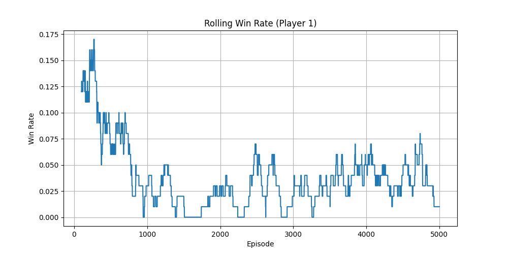
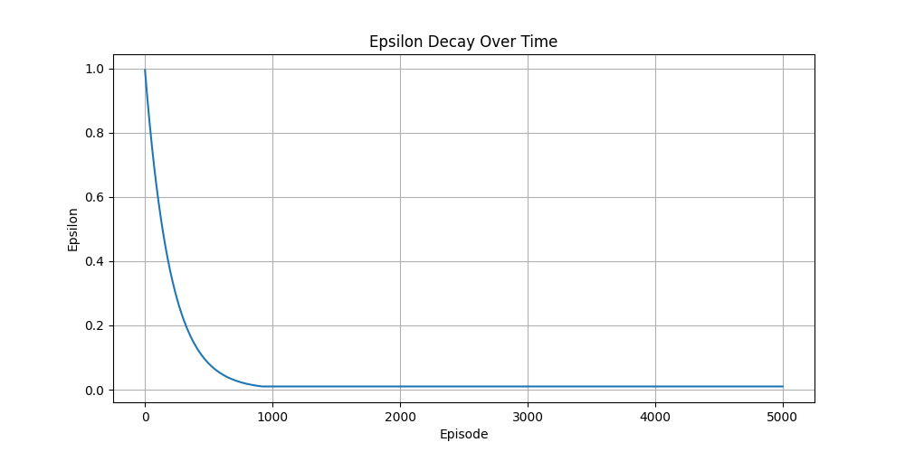

# Morabaraba AI: Q-Learning for a Southern African Board Game

A playable implementation of Morabaraba (the twelve-piece Southern African member of the Morris family) with a PyGame interface and a tabular Q-learning agent trained by self-play. Built for ITRI616 Artificial Intelligence (NWU Honours, 2026), framed with Mitchell's Task, Experience and Performance (TEP) model.



## Project Structure

- **`environment.py`** - Core game engine (~400 lines)
  - Game state management and rule enforcement
  - RL interface: `get_state()`, `get_actions()`, `rl_step(action)`
  - UI interface: `step(position)` for manual play
  - Complete Morabaraba rules:
    - Placement phase (each player places 12 pieces)
    - Movement phase (pieces move on board edges)
    - Flying rule (3-piece players can move anywhere)
    - Mill formation and capture (can't capture from mills unless forced)
    - Win conditions (opponent has <3 pieces or no legal moves)

- **`agent.py`** - Q-Learning agent (~180 lines)
  - Epsilon-greedy action selection
  - Q-value table learning
  - Epsilon decay (0.995 per episode, minimum 0.01)

- **`train.py`** - Self-play training loop (~125 lines)
  - 5000 episodes of self-play
  - Automatic data logging to `results/` folder:
    - `training_data.csv` - Episode stats (episode, winner, epsilon)
    - `training_log.txt` - Detailed logs per episode
  - Progress printed every 10 episodes

- **`main.py`** - PyGame GUI (~330 lines)
  - Interactive board visualization
  - Click to place/move pieces
  - Automatic capture prompts
  - Game-over detection and display

- **`evaluate.py`** - Evaluation against a random opponent
  - `--games`, `--seed` and `--watch` options
  - Writes per-game CSV and a win/loss/draw summary

- **`requirements.txt`** - Dependencies
  - pygame 2.6.1, numpy, pandas, matplotlib

## Running the Game

### 1. Interactive Play (PyGame GUI)
```bash
python main.py
```
- Click on board positions to place pieces during placement phase
- Click piece to select, then click destination to move during movement phase
- Red and black pieces alternate turns
- Game automatically detects and displays winner

### 2. RL Training
```bash
python train.py
```
- Trains AI for 5000 episodes
- Saves results to `results/training_data.csv` and `results/training_log.txt`
- Progress printed every 10 episodes
- Takes ~10-30 minutes depending on system

### 3. Evaluate Trained Agent
```bash
python evaluate.py --games 200 --seed 2026   # against a random opponent
python evaluate.py --watch                   # watch one game in the terminal
python results/graphs.py                     # regenerate training charts
```

## Game Rules

### Board Layout
- 24 positions arranged in 3 concentric squares
- 16 possible mills (3 in a row, on edges or diagonals)
- Positions connected by edges (pieces can only move along connections)

### Phases

#### Placement Phase
- Players alternate placing 12 pieces each on empty board positions
- When 3+ pieces are placed and form a mill, opponent must be captured
- Cannot capture from a mill if open pieces exist elsewhere
- Transition to movement phase after all pieces placed

#### Movement Phase
- Players alternate moving pieces to adjacent empty positions
- Normal rule: Pieces with >3 count move on board edges only
- Flying rule: Players with exactly 3 pieces can move to any empty position
- Capture rules same as placement (remove opponent piece)
- Win if opponent has <3 pieces OR has no legal moves

## RL Integration

### State Representation
28-element tuple:
- `board[24]` - Piece positions (1=player1, -1=player2, 0=empty)
- `selected_piece` - Currently selected piece index (-1 if none)
- `current_player` - Whose turn (1 or -1)
- `capture_mode` - In capture phase (0 or 1)
- `phase` - Game phase (0=placement, 1=movement)

### Action Format
- Tuples: `("place", position)`, `("move", position)`, `("capture", position)`, `("select", position)`
- `get_actions()` returns only legal actions for current state

### Reward Structure (as implemented in `environment.rl_step`)
- Place a piece: +0.5, or +2 if it forms a mill
- Move a piece: +1, or +2 if it forms a mill
- Capture: +1, or +10 if it wins the game
- Reaching the movement phase: +5
- Winning move: +10
- Illegal action: -1

## Results

**Training (5,000 self-play episodes):** epsilon decayed from 1.0 to its 0.01 floor by about episode 920. Only 399 of 5,000 games (8%) produced a winner within the 500-step cap. The Q-table grew to about 3.9 million state–action entries.

**Evaluation against a random opponent** (`python evaluate.py --games 200 --seed 2026`, agent alternates first move; greedy play):

| Agent | Wins | Losses | Draws (500-step cap) |
|---|---|---|---|
| Untrained (all Q = 0) | 5% | 4% | 91% |
| Trained, 5,000 episodes | 7% | 5% | 88% |

The trained agent edges the random baseline, but the gap is small. Most games end at the step cap.



## Known limitations and next steps

Analysis of the results points to four causes:

1. **No perspective flip in self-play.** Both players update one Q-table, but the update adds the *next* player's best value as if it were the mover's own. A negamax-style target (negate the future value when the turn passes) or a board view canonicalised to the side to move would fix this.
2. **Rewards encourage long games.** Every normal move earns +1, so prolonging the game is rewarded. Making ordinary moves neutral and adding an explicit loss penalty should push the agent towards captures and wins.
3. **State space is too large for a table.** Millions of states seen once each cannot generalise in 5,000 episodes. Next would be function approximation (a small neural network or hand-built features such as mills, open mills, mobility and piece difference) or adding a shallow minimax search.
4. **Weak evaluation signal.** Against a random opponent most games hit the step cap even for strong play. Evaluating against a greedy capture-first heuristic opponent would separate good from bad policies more clearly.

A quick experiment applying fix 1 alone (canonical board plus negamax target) did not improve the win rate. That suggests fixes 2–3 matter more and should be done together.

## Technical Details

- **Python 3.11.9** with venv
- **PyGame 2.6.1** (SDL 2.28.4)
- **Episode limit:** 500 steps per episode (prevents infinite loops)
- **Q-Learning hyperparameters:**
  - Learning rate (α) = 0.1
  - Discount factor (γ) = 0.9
  - Initial epsilon = 1.0
  - Epsilon decay = 0.995
  - Minimum epsilon = 0.01

## Files Generated

```
results/
├── training_data.csv        # Episode, winner, epsilon
├── training_log.txt         # Per-episode log
├── qtable.pkl               # Trained Q-table (not committed: large)
├── evaluation_results.csv   # Per-game evaluation results
├── evaluation_summary.txt   # Win/loss/draw summary
└── graphs/                  # Created by results/graphs.py
```

## Troubleshooting

**Issue: Episodes timeout at 500 steps**
- Normal for early training (random play has no clear winner)
- Improves as epsilon decreases and strategy develops

**Issue: No moves available**
- Check `get_actions()` for current game state
- Ensure `has_legal_moves()` properly evaluates flying rule

**Issue: PyGame display issues**
- Requires SDL 2.28+ (included with pygame 2.6.1)
- Tested on Windows 10/11

## Development Notes

All game logic is self-contained in `environment.py`. The RL interface (`rl_step()`, `get_state()`, `get_actions()`) is decoupled from the UI interface (`step()`), allowing:
- Training without graphics (faster)
- Manual play through GUI
- Custom agents (just implement `choose_action()`)
- Game evaluation and analysis

See inline code comments for detailed method documentation.
